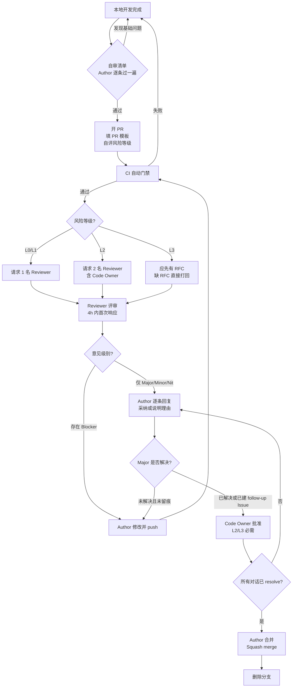

# 02 · 代码审查流程

> 本文定义：**谁做什么**、**端到端怎么流转**、**多久必须响应**、**卡住了怎么办**。

---

## 1. 角色与职责

10 人以内团队不设专职角色，但**每次 PR 都必须明确这四种身份**。

| 角色 | 谁担任 | 职责 | 不做什么 |
| --- | --- | --- | --- |
| **Author**（作者） | PR 提交者 | 自评风险等级、写清 PR 描述、控制 PR 尺寸、自审后再请求评审、及时响应意见 | 不把"请求评审"当"找人点头" |
| **Reviewer**（评审者） | 团队任一成员 | 按 SLA 响应、按检查清单评审、标注意见级别、给出可执行建议 | 不重命名变量之外的代码（见 §5 红线） |
| **Code Owner** | `.github/CODEOWNERS` 指定 | 对其负责模块的变更拥有**强制批准权**；对 L2/L3 变更负责 | 不做唯一评审人（仍需至少 1 名其他 Reviewer） |
| **Maintainer**（维护者） | 仓库管理员（1–2 人） | 维护 CI 与分支保护、裁决争议、每月产出度量报告、每季度修订标准 | 不用管理员权限绕过门禁 |

### Code Owner 分配建议（10 人团队）

| 模块 | 建议 Owner | 理由 |
| --- | --- | --- |
| `packages/ui/src/common/**` | 架构负责人 | 公共契约，影响面最大 |
| `packages/ui/src/composables/**` | 架构负责人 | 跨组件状态契约（§7 明确不可反向依赖） |
| `packages/ui/src/styles/**` | 设计系统负责人 | 三层令牌体系是视觉一致性的根 |
| `packages/ui/src/icons/**` | 图标负责人 | 字体/白名单硬约束 |
| `packages/ui/src/components/wd-*` | 各组件模块负责人 | 按 tier 或业务域划分 |
| `.github/**`、`scripts/**` | 维护者 | 门禁本身不能被随意改 |

> **10 人以下团队的现实做法**：Owner 不必是"专家"，而是"最后把关的人"。
> 组件目录可采用"谁重写谁负责"的原则，未指定目录回退到架构负责人。

---

## 2. 端到端流程

### 文字版流程（便于打印张贴）

1. **自审** → Author 对照 [`03-组件库专项检查清单.md`](./03-组件库专项检查清单.md) 自查
2. **开 PR** → 填写 PR 模板，**自评风险等级**，关联 Issue
3. **CI 门禁** → 规范检查 / 类型检查 / 测试 / 构建校验 / 生成物一致性
4. **请求评审** → L0/L1 请求 1 人；L2 请求 2 人（含 Code Owner）；L3 需 RFC 已合入
5. **评审** → Reviewer 4 小时内首次响应，标注意见级别
6. **回应** → Author 逐条回复：采纳并修改，或说明理由
7. **批准** → L2/L3 需 Code Owner 批准
8. **解决对话** → 所有 review comment 必须 resolve
9. **合并** → Squash merge，删除分支

---

## 3. SLA 与超时处理

| 环节 | SLA | 超时怎么办 |
| --- | --- | --- |
| Reviewer 首次响应 | **4 工作小时** | 在群里 @ 一次；再超时 4h 由 Maintainer 指派他人 |
| Reviewer 完成评审 | **24 工作小时**（L2 为 48h） | Author 可换 Reviewer，原 Reviewer 的意见不再阻塞 |
| Author 响应意见 | **24 工作小时** | PR 被标记 `stale`；超过 5 天未动则关闭 |
| Code Owner 批准（L2/L3） | **24 工作小时** | 由 Maintainer 代为裁决或指派备份 Owner |

### 关于 SLA 的三条说明

- **"工作小时"指团队重合工作时段**，不含夜间与周末。**不要求下班后响应。**
- **SLA 是双向的**：Author 也要在 24 小时内回应意见。挂着不动的 PR 比慢评审更伤害团队。
- **小 PR 是达成 SLA 的前提**。400 行的 PR 没人能在 24 小时内认真评完 —— 遵守 SLA 的义务，从控制尺寸开始。

---

## 4. 冲突解决与升级路径

评审意见分歧是正常的。按以下顺序升级，**每一步都必须留痕在 PR 中**。

| 层级 | 场景 | 处理方式 |
| --- | --- | --- |
| **L1 自行协商** | 对实现方式有不同偏好 | 作者回复理由；若属个人偏好（Nit），作者决定 |
| **L2 规则裁决** | 争议涉及 `CONVENTIONS.md` 某条 | 引用规范原文条目号，以规范为准 |
| **L3 技术裁决** | 规范未覆盖，或规范本身可疑 | 转 Issue 讨论，或提 `[Review Standard]` 修订建议 |
| **L4 维护者裁决** | 双方僵持超过 2 轮 | Maintainer 在 PR 中给出决定并说明理由；若属 L3 争议，升级为 RFC |

### 明确的"作者最终决定权"场景

以下情况**作者有权决定，Reviewer 不应阻塞**：

- Nit 级意见（🔵）
- 规范未覆盖的纯实现风格选择
- 与本次变更无关的重构建议

### 明确的"必须听 Reviewer"场景

- 任何 Blocker（🔴）—— 无可协商
- `CONVENTIONS.md` 有明文规定的条目
- 回归测试相关（不得弱化）
- 静默失效与真机崩溃风险

---

## 5. 评审者的红线（不要做的事）

| 红线 | 为什么 |
| --- | --- |
| ❌ 直接 push 到作者的 PR 分支修改逻辑 | 责任不清、绕过评审；只允许提建议或改明显的 typo（且需留言说明） |
| ❌ 批准自己写的 PR | 自审 ≠ 评审；即使紧急也应找第二人 |
| ❌ 用 "LGTM" 作为唯一意见 | 若确实没问题，请说明**你检查了什么范围**（如"已核对模板类名与 CSS 选择器一致"） |
| ❌ 一次提 30 条 Nit 却漏掉一个字符串 `:style` | 评审预算错配；本库应优先看静默失效类 |
| ❌ 要求作者修复与本次变更无关的既有问题 | 破坏 PR 原子性；应建独立 Issue |
| ❌ 用管理员权限绕过分支保护 | 门禁一旦可绕过就等于没有 |

---

## 6. 特殊场景

### 6.1 紧急修复（Hotfix）

生产故障时流程可以压缩，但**不能跳过**：

| 可压缩 | 不可压缩 |
| --- | --- |
| 审查人数（1 人即可，无需 Code Owner） | CI 必须全绿（若 CI 本身故障，需 Maintainer 在 PR 中留痕说明） |
| 响应 SLA（立即响应） | 必须有回归测试或明确的补测 Issue |
| PR 描述长度 | 事后 24 小时内补一份完整 PR 描述 |

**流程**：开 PR → 标题加 `[HOTFIX]` → 1 人快速批准 → 合并 → **24 小时内补测试与描述**。

### 6.2 依赖升级

`vue-lynx` / `vue` / `rspeedy` 等核心依赖升级：

- 补丁与次版本 → L1，CI 全绿即可
- **主版本 → L3，必须走 RFC + 真机验证**
- 必须附上变更日志中的 Breaking Changes 分析
- `pnpm.overrides`（根 `package.json`）的改动视为 L2 —— 它会静默影响全仓依赖解析

### 6.3 大重构（如 `CONVENTIONS.md` §18 的 tier 重写）

- 必须先有 RFC
- 按 tier 拆分为多个 PR，**每个 PR 自包含且可独立回滚**
- 每个 PR 必须同步更新 `CONVENTIONS.md` §18 的进度表
- 禁止"一次性重写 50 个组件"的巨型 PR

### 6.4 纯文档 / 纯生成物

- 仅 `docs/**` 或 `README.md` → L0，1 人快速过
- 仅 `**/index.css` 变化（无 `index.scss` 变化）→ **可疑**，需确认不是手改产物
- 仅 `pnpm-lock.yaml` 变化 → 确认 `package.json` 是否同步变更

### 6.5 新增组件

新增一个 `wd-xxx` 组件，PR 必须自包含以下**全部**内容，缺一即 Blocker：

- [ ] `types.ts` — props 定义，与 wot-ui 2.3.2 对齐
- [ ] `wd-xxx.vue` — 实现（顶部注释说明 Lynx 适配点）
- [ ] `index.scss` — 消费 `--wd-*` 令牌
- [ ] `index.css` — 由 `build:css` 生成（不得手改）
- [ ] `packages/ui/src/index.ts` 导出
- [ ] `packages/demo/src/App.vue` 演示用例（§11 强制）
- [ ] 测试文件
- [ ] 若涉及图标 → 已确认取自内置 180 个 iconfont 集合（§8）

### 6.6 事件相关改动（高风险专项）

由于 `CONVENTIONS.md` §14 记录了多次事件机制踩坑，**任何改动 `@tap` / `@touchmove` / emits 声明 / `wd-transition` 根链的 PR**：

- 风险等级**至少 L2**
- 必须同步更新并跑通四份回归测试：
  `event-tap-registry` / `event-merge-props` / `event-registry-all-components` / `overlay-tap-regression`
- **禁止用 `fireEvent.click` 断言关闭行为**（§14 明确为假绿）
- L3 场景（改事件机制本身）需附真机验证记录

---

## 7. 每日/每周节奏（10 人团队的最小实践）

| 频率 | 动作 | 耗时 |
| --- | --- | --- |
| 每日 | 每人开工先处理自己收到的评审请求 | 15 分钟 |
| 每日 | 检查是否有超过 24h 未动的 PR，当天清掉 | 5 分钟 |
| 每周 | Maintainer 扫一遍本周 PR 数据（尺寸、时长、轮次） | 15 分钟 |
| 每月 | 评审回顾会：挑 1–2 个 PR 集体复盘 | 30 分钟 |
| 每季度 | 修订 `CONVENTIONS.md` 与本标准 | 1 小时 |

> **每周的"清 PR 日"**：10 人以下团队最容易出现的不是"评审质量差"，而是"PR 挂着没人管"。
> 固定一个时段集中清 PR，比任何规范都有效。
