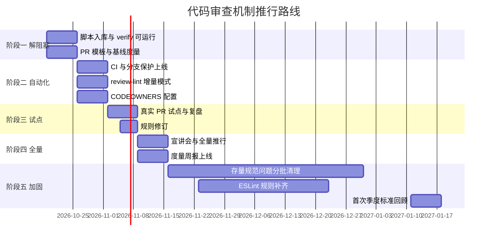

# 06 · 落地推行计划

> 核心原则：**不要一次性推行全部条款。**
> 一个团队能同时接受的流程变化大约只有 2–3 条。推得太猛，结果是全员绕过。

---

## 1. 四周启动计划

### 第 1 周：解除阻塞，建立基线

| 动作 | 产出 | 负责人 |
| --- | --- | --- |
| 将 `scripts/build-css.mjs` 入库，修 `.gitignore` | `pnpm verify` 可运行 | 维护者 |
| 跑通 `pnpm verify`，记录当前错误数 | 基线数据（typecheck 错误数、测试通过数） | 维护者 |
| **裁决 `CONVENTIONS.md` §4 的 PascalCase 规则**（见体检发现 2） | 删除该条 / 或制定整改计划 | 架构负责人 |
| 修复 `packages/demo/src/App.vue:1053` 的字符串 `:style`（见体检发现 1） | 消除一个真实静默失效缺陷 | 维护者 |
| 清理 `_mixin.scss` 中 4 个零使用的 wot-ui 遗留 mixin（见体检发现 3） | 删除死代码 | 维护者 |
| 复制 `pull_request_template.md` 入库 | PR 模板生效 | 维护者 |
| 统计近 30 天 PR：尺寸、时长、轮次 | 基线度量 | 技术负责人 |
| 周会花 15 分钟讲**一条**规则 | 团队知晓 | 技术负责人 |

> **本周唯一硬要求**：`pnpm verify` 能跑。其余都是观察与铺垫。

**本周宣讲的唯一一条规则**：

> **"PR 超过 400 行，作者有义务说明理由或拆分。"**

为什么先讲这条：它是作者**单方面可控**的，不需要任何工具支持，见效最快。

---

### 第 2 周：上自动化门禁

| 动作 | 产出 | 负责人 | 状态 |
| --- | --- | --- | --- |
| PR 模板 + CI 工作流入库 | 门禁文件就位 | 维护者 | ✅ 已随 PR 入库 |
| `scripts/review-lint.mjs` 入库，先用 `--changed` 模式 | 新代码受规范约束 | 维护者 | ✅ 已随 PR 入库 |
| `CODEOWNERS` 配置 | 模块所有权明确 | 技术负责人 | ⬜ 需替换占位团队名 |
| `scripts/build-css.mjs` 入库 | `verify` 可运行 | 维护者 | ⬜ **阻塞项**（体检 P0-1） |
| 打开 GitHub 分支保护 | 门禁强制生效 | 维护者 | ⬜ 需在 Settings 手动开启 |
| 生成物一致性检查生效 | 拦住手改 `index.css` | 维护者 | ⬜ 依赖上一行 |

> **本周关键决策**：`review-lint` 一定要用 `--changed` 模式。
> 全量开启会在 102 个组件上报出大量存量问题，团队会立刻失去信心。

**本周宣讲的第二条规则**：

> **"CI 全绿是合并的前提，任何人不得绕过。"**

---

### 第 3 周：试点与反馈

| 动作 | 产出 | 负责人 |
| --- | --- | --- |
| 选 2–3 个真实 PR 完整走新流程 | 试点记录 | 全员 |
| 记录每个环节的摩擦点 | 摩擦清单 | 技术负责人 |
| 根据摩擦调整 SLA / 规则严格度 | 修订版 | 技术负责人 |
| 组织一次集体评审复盘（选 1 个 PR 当众评） | 统一评审标准 | 技术负责人 |

> **集体评审复盘是本周最有价值的动作。**
> 10 人团队"评审质量参差"的根因，往往不是不认真，而是**每个人对"什么值得提"的判断不同**。
> 当众评一个 PR，能迅速对齐标准 —— 比写十页文档都有效。

---

### 第 4 周：全量推行 + 度量上线

| 动作 | 产出 | 负责人 |
| --- | --- | --- |
| 宣讲会（30 分钟）：讲清标准、流程、清单 | 全员知晓 | 技术负责人 |
| 度量脚本上线（每周自动出数） | 周报 | 维护者 |
| 建立"每周清 PR 日" | 固定节奏 | 全员 |
| `review-lint` 切换到全量 + baseline | 存量问题入 Issue 列表 | 维护者 |

---

## 2. 90 天路线图



### 各阶段目标

| 阶段 | 时间 | 目标 | 成功标准 |
| --- | --- | --- | --- |
| 一 · 解阻塞 | 第 1 周 | `verify` 可运行 | 干净克隆能跑通 `pnpm verify` |
| 二 · 自动化 | 第 2 周 | 门禁生效 | CI 能拦住规范违规 |
| 三 · 试点 | 第 3 周 | 流程可用 | 试点 PR 全程无卡点 |
| 四 · 全量 | 第 4 周 | 全员执行 | 所有 PR 走新流程 |
| 五 · 加固 | 第 2–3 月 | 存量收敛 | 规范问题逐月下降 |

---

## 3. 分阶段开启的规则（重要）

`CONVENTIONS.md` 有 19 节规则，**分批开启**：

| 批次 | 时间 | 开启的规则类别 | 理由 |
| --- | --- | --- | --- |
| **第 1 批** | 第 2 周 | §19 字符串样式、§4 `from 'vue'`、`<style>` 块、调试残留 | 全部是"零误报"的硬规则，且后果严重 |
| **第 2 批** | 第 3 周 | §14 `@click` 绑 view、§5.4 伪元素/`!important`/`:deep`、§15 `inline-flex` | 规则明确，但需少量人工确认 |
| **第 3 批** | 第 4 周 | §8 SVG 白名单、§10 MTS、§5.1 `--wot-*` | 涉及跨文件判断，需更仔细 |
| **第 4 批** | 第 2 月 | §16 `getRect` 热路径、§5.5 类名一致性、§13 `toRaw` | 需语义分析，作为警告而非错误 |
| **第 5 批** | 第 3 月 | ESLint 正式接入（Prettier + TS 规则） | 此时团队已习惯自动化门禁 |

---

## 4. 度量指标

### 每周自动产出的看板

| 指标 | 目标 | 说明 |
| --- | --- | --- |
| PR 首次响应时长（中位数） | < 4 工作小时 | 反映评审响应力 |
| PR 合并周期（中位数） | < 24 工作小时 | 反映整体流转效率 |
| PR 有效 diff 中位数 | < 200 行 | 反映 PR 纪律 |
| 评审轮次（中位数） | < 2 轮 | 反映沟通质量 |
| CI 首次通过率 | > 80% | 反映本地自审质量 |
| 门禁 bypass 次数 | < 2 次/月 | **门禁健康度核心指标** |
| 缺陷逃逸数 | 逐月下降 | 最终效果指标 |

### ⛔ 明确禁止用于考核的指标

评审意见数量 · 评审意见字数 · 批准速度 · 每人评审次数 · 测试覆盖率绝对值

> 见 [`05`](./05-自动化门禁与CI配置.md) §7 的说明。**度量流程，不度量人。**

---

## 5. 常见阻力与应对

| 阻力 | 真实原因 | 应对 |
| --- | --- | --- |
| **"没时间评审"** | PR 太大 + 没有固定时段 | 控制尺寸 + 设立"每日 15 分钟清 PR" |
| **"评了也没用，问题还是上线上"** | 评审没聚焦在真正的风险上 | 用真实缺陷逃逸案例复盘，把注意力引向 §A/§B |
| **"标准太严，做不完"** | 一次性全量开启 | 分批开启 + `--changed` 增量模式 |
| **"评审变成吵架"** | 缺少沟通规范 | 推行 [`04`](./04-评审意见与沟通规范.md) 的标签体系 |
| **"LGTM 走过场"** | 没有"要检查什么"的抓手 | 给检查清单；要求 LGTM 必须说明检查范围 |
| **"CI 老失败，烦"** | 本地没自审 | 提供 `pnpm verify` 一键脚本 + PR 模板中的自审清单 |
| **"这是形式主义"** | 之前推行过又废掉的流程 | 从"能自动化"的部分切入，先做出可见收益（如拦住一次真机崩溃） |
| **"规范是给人看的，不是给机器看的"** | 认为 `CONVENTIONS.md` 已经够了 | 用体检数据回应：19 节规范，0 条自动化，102 个组件靠人肉记忆 |

---

## 6. 判断机制是否在退化的信号

每月回顾会对照检查，**命中 2 条以上需立即干预**：

- [ ] 出现只有 "LGTM" 的批准
- [ ] PR 有效 diff 中位数回升到 400 行以上
- [ ] 有 PR 存活超过 5 天
- [ ] 有回归测试被 `.skip` 或删除
- [ ] 有人用管理员权限 bypass 门禁
- [ ] 连续两周无人提出 `praise:` 级评论
- [ ] `review-lint` 报错被加入 baseline 豁免清单
- [ ] 评审意见中 Nit 占比超过 30%
- [ ] 出现"这问题上次也说过"的重复讨论

---

## 7. 一页纸执行摘要（可打印张贴）

```
┌─────────────────────────────────────────────────────────┐
│              wot-lynx-ui 代码审查 · 一页纸               │
├─────────────────────────────────────────────────────────┤
│ 开 PR 前（作者）                                          │
│   □ 自评风险等级 L0–L3                                    │
│   □ 有效 diff ≤ 400 行（index.css / lock 不计）           │
│   □ 跑过 pnpm verify，附上结果                            │
│   □ 对照 03-检查清单 自查                                 │
├─────────────────────────────────────────────────────────┤
│ 评审时（Reviewer）· 4 小时内首次响应                       │
│   优先级：静默失效 → 真机崩溃 → 布局 → 事件 → 规范 → 测试 │
│   □ 每条意见标级别：🔴🟠🟡🔵💬🟢                          │
│   □ 说清"为什么"和"怎么改"                                │
│   □ 至少一条 🟢 praise                                    │
│   □ 不提 ESLint 能管的意见                                │
├─────────────────────────────────────────────────────────┤
│ 合并前                                                    │
│   □ CI 全绿（规范/类型/测试/生成物/构建）                  │
│   □ L2/L3 有 Code Owner 批准                              │
│   □ 所有对话已 resolve                                    │
│   □ Squash merge                                          │
├─────────────────────────────────────────────────────────┤
│ 绝对红线（🔴 一律阻塞）                                   │
│   · 字符串 :style          · SVG 白名单外元素             │
│   · 类名与 CSS 选择器错配   · Main Thread Script          │
│   · @click 绑在 view 上     · 回归测试被弱化/删除         │
│   · 手改 index.css          · 静默吞掉的错误              │
└─────────────────────────────────────────────────────────┘
```
